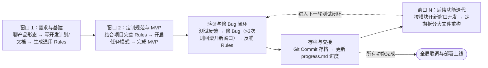
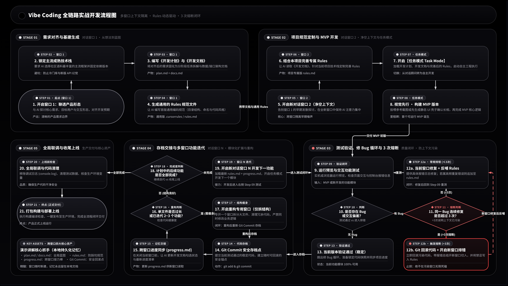

# Vibe Coding 实战全链路指南（深度讲解）

> **一句话心法：用文档换记忆，用 Git 换安全，用新窗口换清醒。**
> AI 的上下文会污染，那就别让它污染——每完成一段就存档、交接、开新窗口。

本页是 [流程图](https://yanjikang.github.io/vibe-coding-workflow/) 的完整文字版：流程图给你骨架，这里给你能直接照做的肌肉。配套四份模板见 [templates/](templates/)。

## 宏观速览

六个齿轮咬合转一圈，就是一个功能从立项到上线的完整生命周期：





**[👉 打开交互式完整版](https://yanjikang.github.io/vibe-coding-workflow/)**（21 步 · 5 阶段，支持缩放分层查看）

## 跨窗口核心资产与交接规范

Vibe Coding 高度依赖「多开新窗口」来保持 AI 注意力集中——**AI 没有跨会话记忆，窗口之间的记忆传递 100% 依靠本地文档**。

| 核心资产 | 产生阶段 | 核心作用 | 更新与维护时机 | 模板 |
| :--- | :--- | :--- | :--- | :--- |
| **plan.md / docs.md** | 窗口 1 | 产品形态、技术栈版本、数据与接口架构蓝图 | 架构变动时同步更新，所有后续窗口的背景基准 | [plan.md](templates/plan.md) · [docs.md](templates/docs.md) |
| **rules.md** | 窗口 1 通用版 → 窗口 2 定制版 | 目录规范、命名约定、代码风格与严禁踩坑的禁令 | 修 Bug 循环中发现 AI 重复犯错时，立即追加禁令 | [rules.md](templates/rules.md) |
| **progress.md** | MVP 完成后建立 | 已完成功能、当前状态、下一步待办 | **每次关旧窗、开新窗前**必须让 AI 更新 | [progress.md](templates/progress.md) |
| **Git Commit** | 贯穿全程 | 验证通过的代码快照，随时可回滚的安全锚点 | ① MVP 跑通 ② 每个功能测试通过 ③ 重构完成 | — |

> **交接三件套**：开启新窗口时，让 AI 依次读取——
> ① 最新 Rules → ② progress.md → ③ 开发文档中与本次任务相关的章节。缺一不可。

## 熔断机制：什么时候该放弃当前窗口

> ⚠️ **三次定律**：同一个 Bug 修满 3 次仍不过，就别修了——**不是你不行，是这个窗口的上下文已经被污染了**。
> AI 此时会拿着前面一堆错误假设反复打补丁，越修越歪。

熔断四步走：

1. **止损回滚** — `git checkout .` 或 `git reset --hard <存档commit>`，把污染代码丢掉
2. **提炼归因** — 让 AI 总结：这次到底错在哪、报错链路是什么、哪个假设从一开始就错了
3. **换窗重启** — 开全新窗口，只投喂【纯净代码 + 归因总结】，重新切入
4. **反哺 Rules** — 把这次教训写成一条禁令，进 Rules 文件

## Rules 反哺：把踩过的坑变成禁令

让同一类错误**只犯一次**，是整个工作流复利最大的动作。Rules 条目建议这样写：

```markdown
## 严禁事项（踩坑沉淀区）

- ❌ 禁止在组件内直接写 `fetch`，一律走 `src/api/request.ts` 统一封装
- ❌ 禁止使用 `any` 类型；接口返回必须定义 interface
- ❌ 修改组件前必须先读 `progress.md`，确认不重复开发已完成功能
- ❌ 禁止在未确认数据库表结构前编写查询语句
```

> **触发条件**：不是每遇到小 Bug 就写禁令——当同一个错误**重复出现第 2 次**，或暴露出一条系统性约定缺失时，才追加。Rules 臃肿了 AI 也会抓不住重点。

## 实战执行检查清单（SOP）

新项目直接复制这份清单跟踪推进状态：

**窗口 1（立项与基建）**
- [ ] 与 AI 聊透产品形态，明确选用主流成熟技术栈
- [ ] 产出《开发计划》《开发文档》与《通用 Rules》（从 [templates/](templates/) 复制起步）

**窗口 2（规范定制与 MVP）**
- [ ] 开启新窗口，让 AI 读取《开发文档》后针对本项目完善 Rules
- [ ] 开启任务模式，先确认前端静态 UI / 原型长相（视觉先行）
- [ ] 再让 AI 完整实现 MVP 核心链路

**测试与熔断守则**
- [ ] 运行测试并反馈报错（附完整报错日志，而非"它坏了"）
- [ ] 同一 Bug 连续修 3 次未果，立即执行回滚 + 归因 + 换窗口
- [ ] 高频错误反哺进 Rules 严禁事项

**节点存档与交接**
- [ ] 功能测试通过后执行 `git commit` 存档
- [ ] 让 AI 更新 `progress.md` 及 Rules 避坑条目

**窗口 N（后续功能与重构）**
- [ ] 每做一个新功能都开启新窗口（投喂 Rules + progress.md）
- [ ] 每迭代 2~3 个功能检查单文件行数，及时专开窗口拆分大文件（只拆结构，不改业务逻辑）

**收尾上线**
- [ ] 清理调试日志与测试数据
- [ ] 核查环境变量，打包构建并部署

## 五分钟上手示例

1. 在项目根目录建 `docs/` 文件夹，把 [templates/](templates/) 下四个文件复制进去
2. **窗口 1** 对 AI 说：
   > 我想做一个〔一句话产品想法〕。先别写代码，我们逐步对齐：产品形态 → 技术栈（只选主流成熟方案并锁版本）→ 按 docs/plan.md 模板产出开发计划和文档 → 按 docs/rules.md 模板生成通用规范
3. **窗口 2** 对 AI 说：
   > 读取 docs/plan.md、docs/docs.md 和 docs/rules.md，先针对本项目完善 rules.md，然后进入任务模式：先出静态 UI 壳子给我确认，再实现 MVP
4. 之后每轮迭代都从"交接三件套"开始：**Rules → progress.md → 相关文档章节**
